# 课序 · Coursely

> **不只是课表。** 课程表 / 每日暖言 / 作业 DDL / 专注番茄钟 / 粘贴导入 / 桌面小组件 —— iOS 质感，一个 App 全搞定。

<p>
  
  
  
  
  
</p>

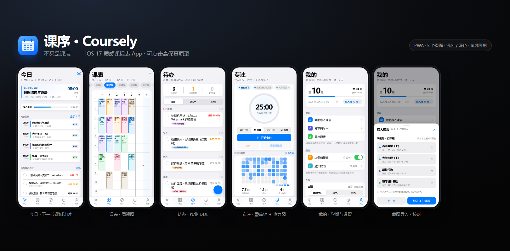

---

## 这是什么

一个给大学生用的课程表 App。**两种形态，共用同一份界面**：

| 形态 | 说明 |
|---|---|
| **Web / PWA** | `node tools/serve.js` 就能跑，手机浏览器「添加到主屏幕」即全屏 App，支持离线 |
| **Android App** | Kotlin 外壳 + WebView 承载同一份页面，额外拿到**离线 OCR / 桌面小组件 / 后台提醒 / 品牌开屏** |

界面是**原生 HTML/CSS/JS 手写**的（没有框架、没有构建步骤、没有 npm 依赖）；
Android 侧只写网页做不到的那部分：相机、离线识别、闹钟、小组件、启动动画。

| 今日 | 课表 |
|---|---|
| 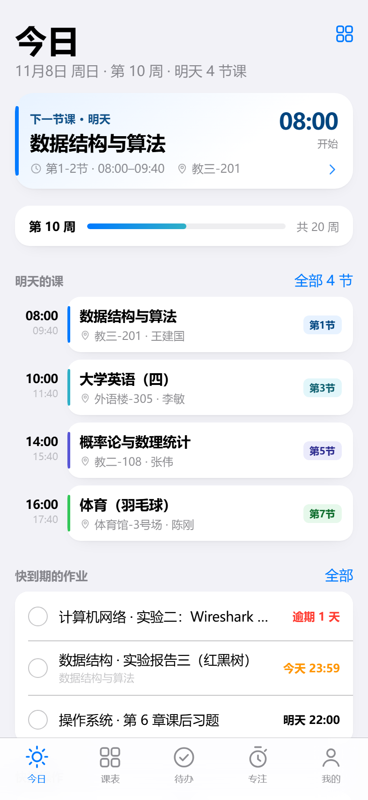 | 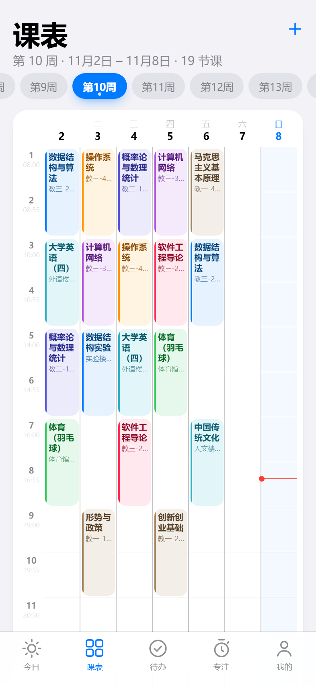 |

| 待办 | 专注 |
|---|---|
| 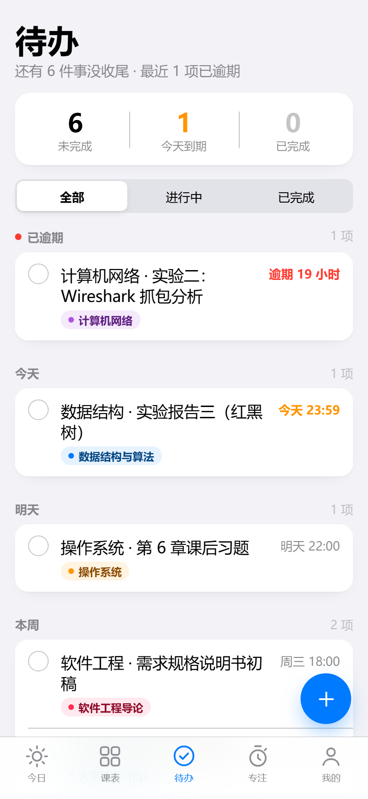 | 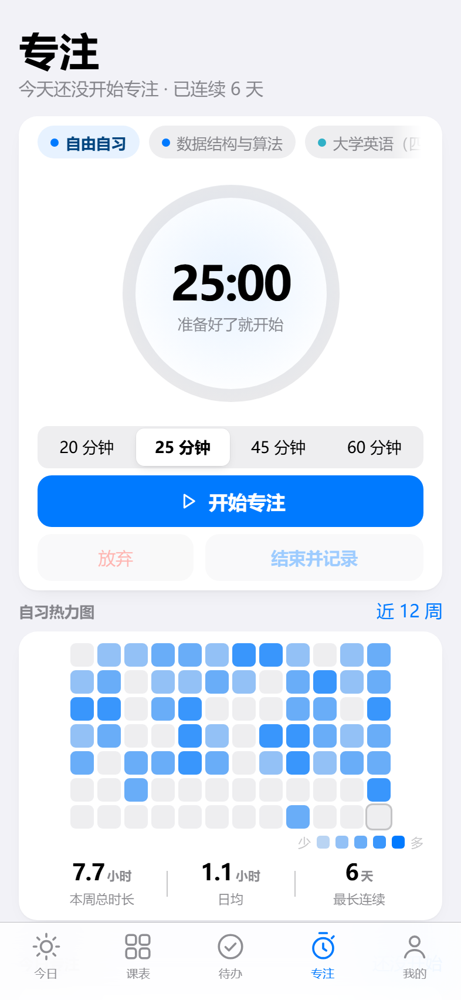 |

| 每日暖言 | 我的（设置全在这） |
|---|---|
| 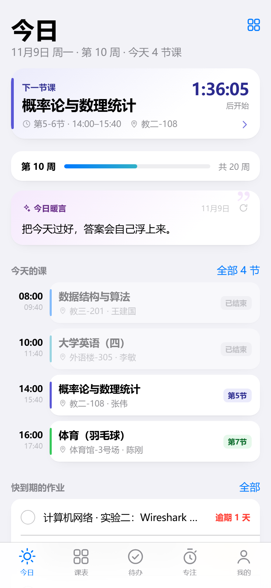 | 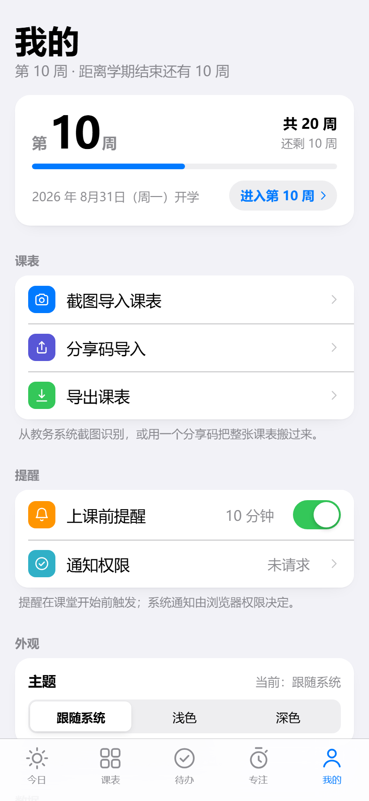 |

---

## 功能

**课表**

- 周视图：任意周切换、单双周、当前时间红标、点课程看详情 / 编辑 / 删除
- 添加课程：时间冲突检测、8 套课程配色、连上节次、起止周
- 学期设置：开学日期（一键对齐本周一）+ 学期总周数，实时预览「今天是第几周」
- 作息时间：8/10/12/14 节一键切换，或逐节改上下课时间，改完整套界面跟着变

**今日**

- 「下一节课」卡片：正在上课显示剩余倒计时，未开始显示距开课倒计时，隔天显示明天几点
- **每日暖言**：按日期确定性挑一句（同一天始终同一条、跨天自动换），可关闭、可换成自己的句子
- 今日时间轴、快到期的作业、快捷入口

**待办**

- 按「已逾期 / 今天 / 明天 / 本周 / 以后」自动分组，逾期红、今天橙
- 勾选完成、编辑、删除、按状态筛选

**专注**

- 番茄钟（20/25/45/60 分钟）+ 近 12 周自习热力图 + 本周时长/日均/最长连续

**导入课表**（三个入口，按准确率排序）

1. **粘贴导入（推荐）**：教务系统网页长按全选复制 → 回 App 粘贴 → 自动还原成网格。
   文本无损，不联网、不拍照、不依赖任何 OCR 服务；也支持 Excel 复制和「一行一门」手写
2. 截图识别（实验）：Android 端用 **ML Kit 离线中文识别**，受照片质量影响
3. 分享码 / 手动添加

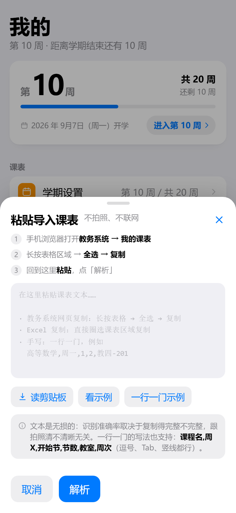
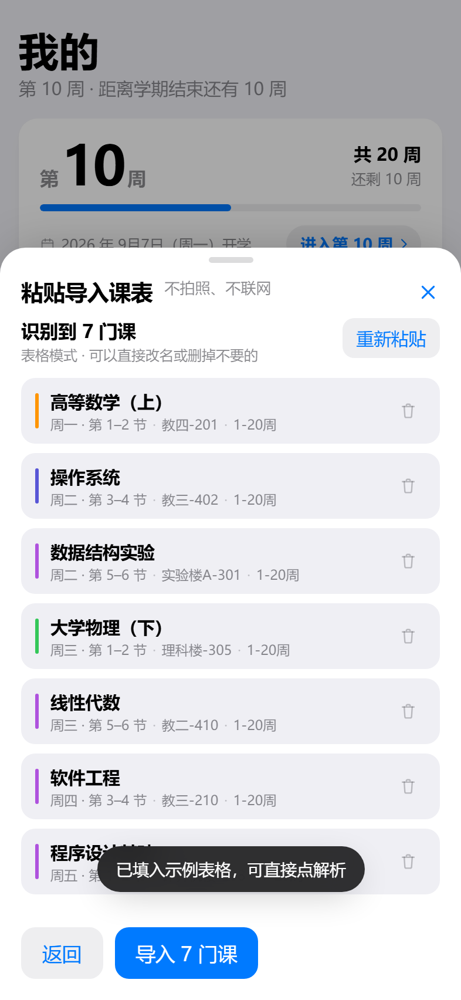

**Android 独有**

| 能力 | 说明 |
|---|---|
| 桌面小组件 | 今日课表 4×2、下节课倒计时 2×2；倒计时用原生 `Chronometer` 自走，不耗电 |
| 后台提醒 | 作业到期提醒 + 免打扰时段（跨零点），App 关掉也能响 |
| 开屏动画 | 逐笔描绘 + 双圈涟漪 + 进度条，`Canvas` + `PathMeasure` 手写，无第三方动画库 |
| 离线 OCR | 中文模型打包进 APK，零网络、不需要 Google 服务 |

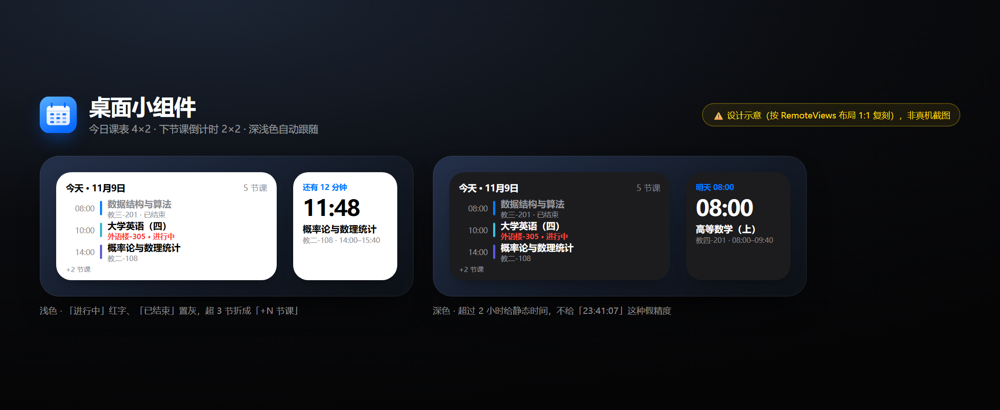
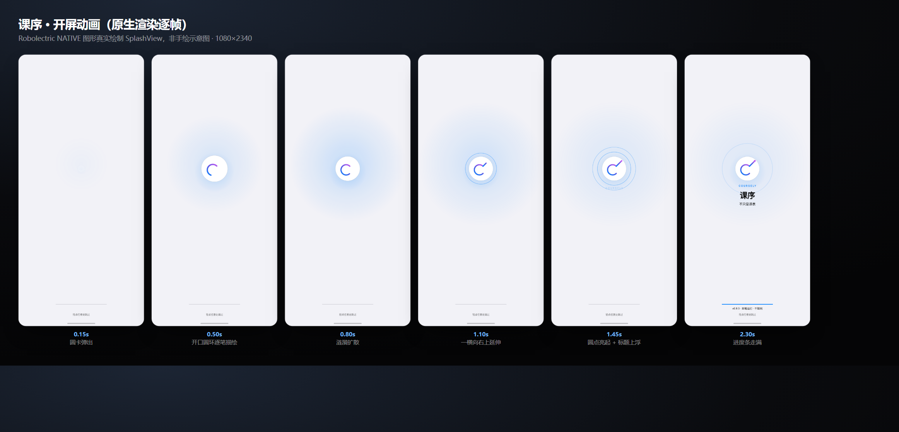

---

## 快速开始

### Web / PWA

```bash
cd web
node tools/serve.js 8765
# 打开 http://127.0.0.1:8765/
```

零依赖、零构建。改完刷新即生效。手机同一 Wi-Fi 访问 `http://<电脑IP>:8765/`，
Safari/Chrome「添加到主屏幕」就是全屏 App（已配 manifest + Service Worker 离线缓存）。

### Android

前置：**JDK 17** + **Android SDK**（platform 34 / build-tools 34）

```bash
export JAVA_HOME="<JDK-17>"
export ANDROID_HOME="<Android SDK>"

cd android
powershell -ExecutionPolicy Bypass -File tools/build.ps1 -Mode release
# 产物：app/build/outputs/apk/release/app-arm64-v8a-release.apk
```

`build.ps1` 会先把 `web/` 同步进 `android/app/src/main/assets/www/`，再编译。
也可以手动分步：`tools/sync-web.ps1` → `./gradlew assembleRelease`。

> 想跑单测：`./gradlew testDebugUnitTest`。若工程路径含中文，需要先建一个 ASCII 目录联接
> （Gradle 对非 ASCII 路径的老问题），详见 [android/README.md](android/README.md)。

---

## 工程结构

```
.
├── web/                     # 网页（PWA）。UI 的唯一真身
│   ├── index.html
│   ├── css/                 # tokens(设计变量) / base(组件库) / 各页面样式
│   ├── js/
│   │   ├── store.js         # 状态 + localStorage + 迁移
│   │   ├── domain.js        # 周次/时间轴/下一节课/待办分组等纯计算
│   │   ├── ui.js            # DOM 助手 / 图标库 / Sheet / Toast
│   │   ├── app.js           # 路由 / Tab / 主题 / 提醒引擎
│   │   ├── android.js       # 原生桥（浏览器里自动降级为空实现）
│   │   ├── fortunes.js      # 每日暖言
│   │   ├── paste-parse.js   # 粘贴导入解析器（纯函数）
│   │   ├── native-ocr.js    # OCR 文本 → 课程（纯函数）
│   │   └── pages/           # today / schedule / todos / focus / me
│   └── tools/               # 静态服务器 + 无头浏览器截图器
├── android/                 # Android 外壳
│   └── app/src/main/java/com/local/coursely/
│       ├── MainActivity.kt      # WebView + AssetLoader + 开屏
│       ├── bridge/              # JS ↔ 原生 协议实现
│       ├── splash/SplashView.kt # 开屏动画（Canvas）
│       ├── widget/              # 桌面小组件
│       ├── reminder/            # AlarmManager 通知
│       ├── ocr/                 # ML Kit 中文离线识别
│       └── photo/               # 相机 / 相册
└── docs/
    ├── CONTRACT-web.md      # 网页层架构与接口约定
    ├── BRIDGE-CONTRACT.md   # 网页 ↔ 原生 协议
    └── screenshots/
```

---

## 几个实现上的取舍

- **为什么用 WebView 而不是纯原生**：这套 UI 已经在浏览器里逐页验证过，而 Android WebView 就是同一个
  Chromium 内核，渲染一致性高；原生只做网页做不到的事（相机 / 离线 OCR / 闹钟 / 小组件 / 开屏）。
  网页用 `WebViewAssetLoader` 以 `https://appassets.androidplatform.net` 这个安全源提供，`localStorage` 才能持久化。
- **零联网不是口号**：ML Kit 的 AAR 会在 manifest merge 时塞进 `INTERNET` 权限，项目在
  `AndroidManifest.xml` 里用 `tools:node="remove"` 显式移除，并写了单测守住这条。
- **小组件拿不到 WebView 的数据**：所以网页把「未来 14 天的课程事件（绝对时间戳）」推给原生存一份，
  小组件自己算「今天 / 下节课」，App 没打开也能显示对。
- **粘贴导入优于 OCR**：OCR 把结构化数据降级成像素，再花力气从像素里捞结构，本质上亏；
  课表是表格文本，复制粘贴是无损的 —— 所以主路径换成粘贴，OCR 降级为实验功能。
- **每日暖言按日期哈希**：同一天刷新永远是同一句，不会刷一次变一句。

---

## 隐私

- **无网络权限**（Android 包的 manifest 里没有 `INTERNET`）
- 课表、待办、专注记录只存在本机 `localStorage` / `SharedPreferences`
- 无账号、无统计、无广告、无第三方 SDK（除 ML Kit 离线模型）

---

## 测试状态

| 部分 | 状态 |
|---|---|
| Web UI | 五个页面 + 各弹层，逐页无头浏览器截图核验，深浅色、393px 无横向滚动 |
| 数据逻辑 | 有 E2E 验证（加课/刷新持久化/粘贴解析 5 种输入/免打扰边界/作息切换） |
| Android 构建 | release 构建通过，`aapt2` 校验图标/权限/原生库，47 个单测通过 |
| Android 运行 | **未在真机上做过完整验收**（开发机没有设备/模拟器）；相机、闹钟、小组件请以真机为准 |
| 开屏动画 | 用 Robolectric 的 native 图形把 `SplashView` 逐帧渲染成 PNG 核验（见 `android/README.md`） |

---

## 路线图

- [ ] 桌面小组件配置（行数 / 是否显示教室 / 配色）
- [ ] 课表外观（每周起始日、隐藏周末、格子密度）
- [ ] 首页模块排序 / 隐藏
- [ ] 自定义强调色
- [ ] 多学期管理（历史学期归档）
- [ ] 调休 / 补课日标记

---

## 许可

[MIT](LICENSE) © 2026 Techxey

图标与开屏标记取自作者本人另一个作品的品牌标记（开口的圆环 = 0，向右上的一笔 = 1，末端的圆点 = 尚未写完的下一笔）。
