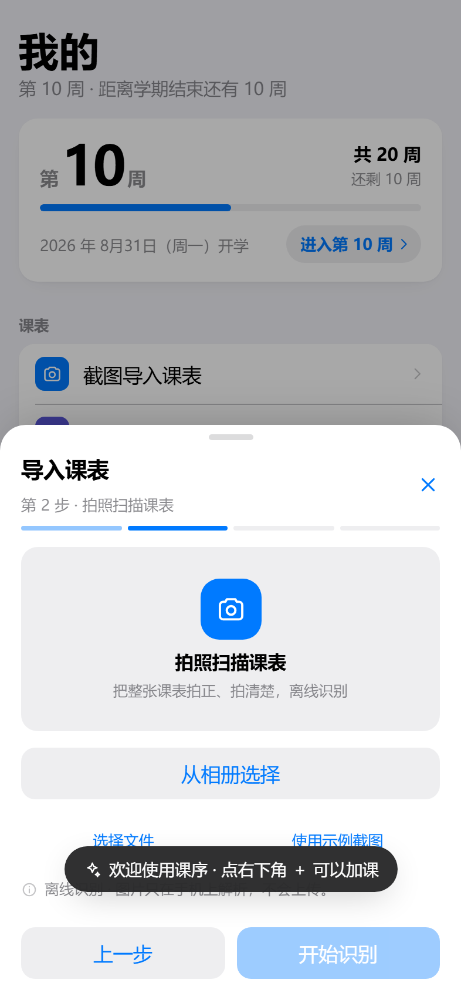
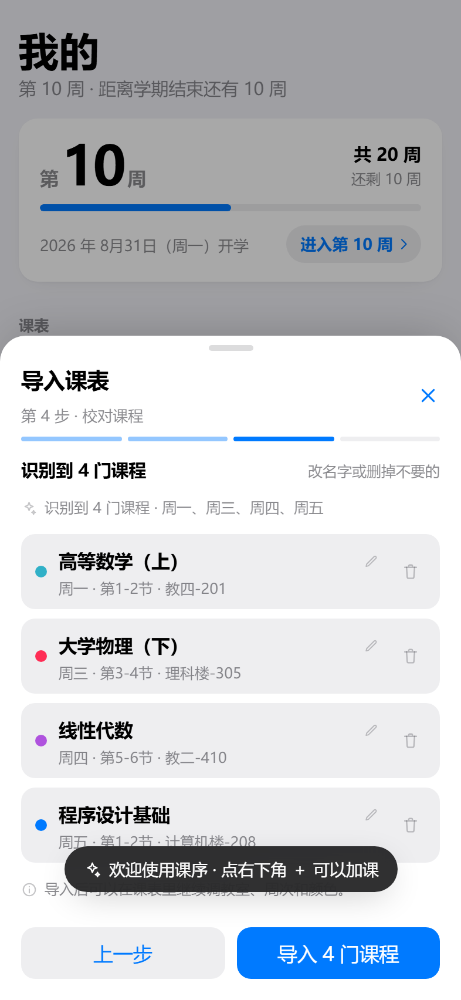
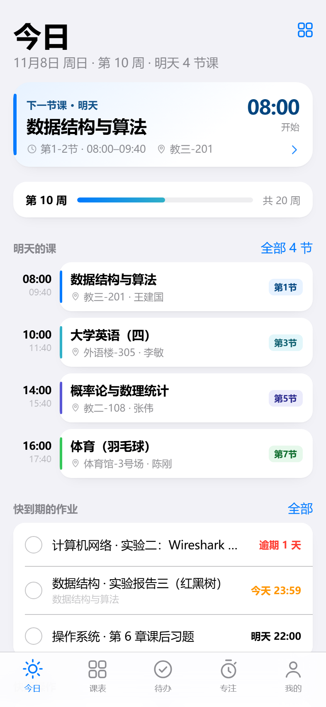
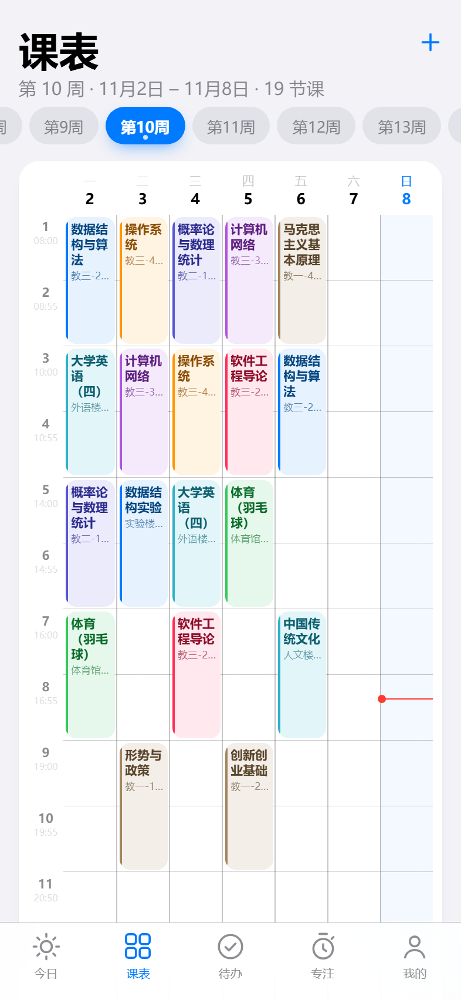
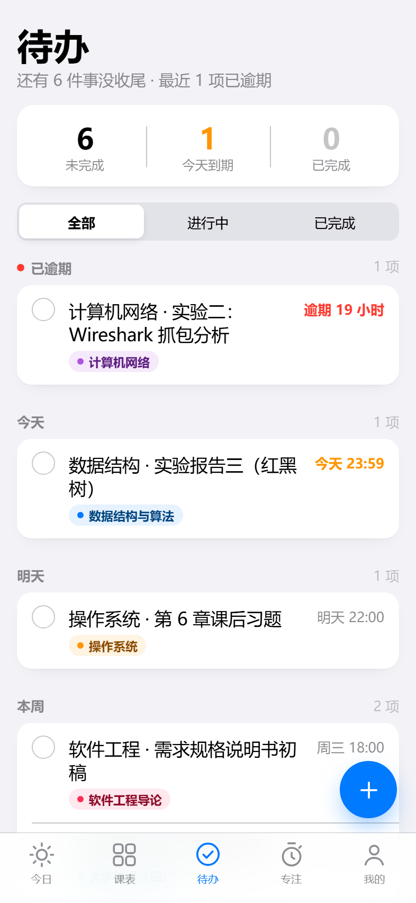
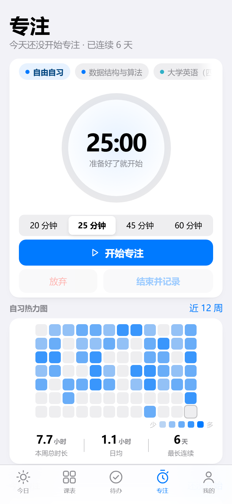
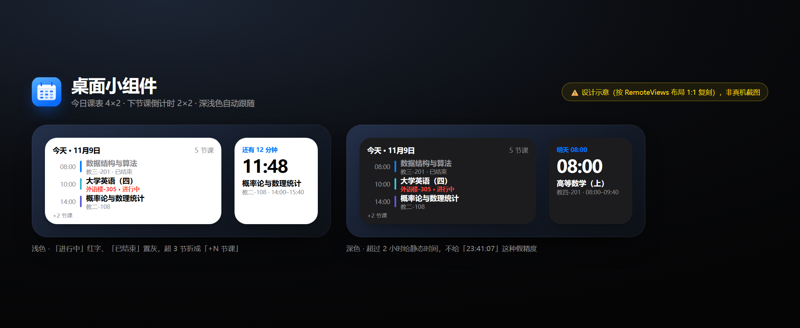

# 课序 · Android 版（Coursely for Android）

> **不只是课表。** 一个能装到手机上的原生 Android App：
> 课程表 / 下一节课倒计时 / 作业 DDL / 专注番茄钟 / **拍照扫描课表（离线 OCR）** / **后台提醒**。

| | |
|---|---|
| 包名 | `com.local.coursely` |
| 版本 | `0.9.0`（versionCode 9） |
| 支持 | Android 8.0（API 26）及以上 |
| 产物 | 见下方 **§5 产物与体积**（推荐 `Coursely-0.9.0-arm64-v8a.apk`，**6.52 MB**） |
| 语言 | Kotlin + WebView 外壳（UI 复用已验证的网页层） |
| 网络 | **零联网权限**（manifest 里连 `INTERNET` 都没有） |

---

## 0. 界面

UI 与网页版共用同一份 HTML/CSS（Android WebView 就是同一个 Chromium 内核），
以下截图来自该页面在 Chromium 的渲染，**尚未在真机截屏**：

> v0.3.0 起，「今日」页在周进度下面多了一张**每日暖言**卡片：按日期确定性选一句（同一天始终同一条、
> 跨天自动换，工作日/周末不同语料池），轻点换下一条。属于网页层功能，原生不需要改动。

> v0.4.0 / v0.5.0 起，「我的」页变成**全部自定义入口**（仍然只有这一页，不占导航栏）：
> **学期设置**（开学日期 + 总周数）、**作息时间**（8/10/12/14 节，逐节起止时间）、
> **免打扰时段**（跨零点静默）、**每日暖言**（开关 + 自定义语录）、**逐门课提醒**（课表里每门课单独设提前量）。
> 改作息后课表格子数、时间轴、提醒、桌面小组件全部联动；这些也都是网页层改动。

> v0.6.0 起，**课表导入主路径换成「粘贴导入」**（教务系统网页全选复制 → 回 App 粘贴 → 解析），
> 文本无损、不联网、准确率接近 100%；原来的截图识别降级为「实验」，仍可用但不推荐。

> v0.7.0 起：**不内置任何示例数据**（全新安装是空课表，首屏直接引导导入）；**移除「上课前提醒」**，
> 只保留作业到期提醒 + 免打扰时段；存储版本号升到 v2，旧版示例课表不迁移。

> v0.8.0 换了图标：标记取自已做好的个人主页**开屏动画**（开口的圆环 = 0，向右上的一笔 = 1，
> 未落笔的圆点）。自适应图标三层齐全（渐变背景 + 白色标记前景 + Android 13 单色层），系统开屏会自动用它。

| 拍照扫描课表（原生 OCR） | 校对页 |
|---|---|
|  |  |

| 今日 | 课表 | 待办 | 专注 |
|---|---|---|---|
|  |  |  |  |

---

## 1. 安装

**方式 A：adb**

```powershell
# 先看手机是 64 位还是 32 位（返回 abilist 里含 arm64-v8a 就装 arm64 包）
adb shell getprop ro.product.cpu.abilist

adb install -r "android/\dist\Coursely-0.9.0-arm64-v8a.apk"   # 推荐，6.52 MB
# 老机器（32 位）改用：
# adb install -r "android/\dist\Coursely-0.9.0-armeabi-v7a.apk"
```

**方式 B：直接传手机**
把 APK 传到手机（微信文件传输 / 数据线 / 网盘），点击安装；首次会提示「允许安装未知来源应用」。

> 首次打开会申请「通知」权限 —— 只用于上课前提醒和作业到期提醒，拒绝也能正常用。

---

## 2. 它和网页版是什么关系

**同一份 UI，两种外壳。**

```
        ┌──────────────────────────────┐
        │  网页层（web/）    │  ← 唯一的 UI 真身
        │  index.html + css + js       │     今日/课表/待办/专注/我的
        └──────────────┬───────────────┘
                       │ tools/sync-web.ps1 构建时同步
        ┌──────────────┴───────────────┐
        │  Android 外壳 (Kotlin)        │
        │  MainActivity + NativeBridge │
        └──────────────────────────────┘
```

- 网页层通过 **`WebViewAssetLoader`** 以 `https://appassets.androidplatform.net/` 这个**安全源**提供
  → `localStorage` 可持久化（课表重启不丢），也不会出现 `file://` 下存储被禁的问题。
- 网页层检测到 `window.CourselyNative` 就启用原生分支，**在普通浏览器里自动降级为 no-op**，
  所以同一份代码既是 PWA 也是 App 界面。

这样做的好处很直接：UI 已经在浏览器里逐页截图验证过，Android WebView 就是同一个 Chromium 内核，
**渲染一致性高**；原生只做网页做不到的事（拍照 / 离线 OCR / 后台闹钟）。

---

## 3. 原生能力（网页做不到的三件事）

### 3.1 拍照 / 相册（`photo/`）
- 走系统相机 App（`ACTION_IMAGE_CAPTURE` + `FileProvider`），**不申请 CAMERA 权限**，
  不弹权限框，不用自己写相机 UI。
- 相册：API 33+ 用 `ACTION_PICK_IMAGES`（系统照片选择器，无需存储权限），低版本降级 `ACTION_GET_CONTENT`。
- 图片统一缩放到长边 1600px、JPEG 85 再交给 OCR，兼顾清晰度和内存。

### 3.2 离线 OCR（`ocr/`）
- **ML Kit `text-recognition-chinese`**，模型打包进 APK（`assets/mlkit-google-ocr-models/`）。
- **完全离线**：不联网、不需要 Google Play 服务、不需要任何账号。
- 返回每行文字的**归一化坐标**（x/y/w/h ∈ 0–1）+ 字高，交给网页侧的解析器还原成课表网格。

### 3.3 后台提醒（`reminder/`）
- `AlarmManager` + `Notification`，**App 关掉也能响**（这是网页/PWA 做不到的）。
- 能精确则 `setExactAndAllowWhileIdle`，没有精确闹钟权限则 `setAndAllowWhileIdle` 并如实回报。
- 排过的提醒 id 与内容同时落盘 `SharedPreferences`，**开机 / 应用升级后自动重排**（`BootReceiver`）。

### 3.4 桌面小组件（`widget/`）

长按桌面 → 小组件 → 课序，拖出来即可。

| 小组件 | 建议尺寸 | 内容 |
|---|---|---|
| **今日课表** | 4×2（可缩放） | 今天的时间 + 课程名 + 教室；正在上的标「进行中」（强调色），上完的置灰标「已结束」；4×2 高度只放 **3 行**（双行文本再塞 1 行会被 launcher 裁掉教室），更多课时显示「+N 节课」；左侧色条沿用 App 的 8 色课程色板 |
| **下节课倒计时** | 2×2 | 距下一节课还有多久：2 小时内用**原生 `Chronometer` 秒级倒计时**，更远显示「明天 08:00」；上课中则倒计时到下课 |



> 上图是按 RemoteViews 布局（padding/字号/颜色/圆角）1:1 复刻的设计示意，**不是真机截图**——本机没有 Android 设备。

**它为什么能显示对（关键设计）**

小组件是独立进程，**读不到 WebView 里的 localStorage**，所以做了「快照 + 本地推算」：

```
课序 App（WebView）              原生                             桌面
──────────────────             ────                             ────
课程表一变就推送                存 SharedPreferences         →   小组件读快照，
「未来 14 天的事件」  ────────▶  并立刻重绘                       自己算「今天 / 下节课」
（带绝对毫秒时间戳）
```

- 推的是**绝对时间戳**而不是「第几周第几节」→ App 没打开也能算对；
- 倒计时交给 `Chronometer` 自己走秒，**不需要每秒/每分钟唤醒**；
- 只在**午夜**和**上下课边界**用 `AlarmManager` 唤醒重绘，另外系统 `updatePeriodMillis=30min` 兜底。

页面改完课表（加课/删课/换教室）→ 小组件立刻跟着变，不用重开 App。

---

### 3.5 开屏动画（`splash/`）

把个人主页那套开屏 1:1 移植成了原生绘制（`SplashView`，纯 Canvas + 时间轴，不加载 WebView）：

| 元素 | 起始 | 时长 | 说明 |
|---|---|---|---|
| 光晕 | 0.05s | 1.5s | 蓝色径向渐变，scale .35 → 1.15，透明度 0 → .85 → .42 |
| 圆卡 | 0.10s | 0.78s | spring 弹出（scale .62 → 1） |
| 圆环（开口的 0） | 0.18s | 0.85s | `PathMeasure` 裁切，逐笔描绘 |
| 一笔（1） | 1.00s | 0.40s | 从缺口向右上延伸 |
| 圆点 | 1.35s | 0.40s | spring 点亮 |
| 双圈涟漪 | 0.90 / 1.20s | 1.5s | scale .85 → 2.1，淡出 |
| 标题上浮 | 1.40 / 1.50 / 1.62s | ~0.5s | COURSELY → 课序 → 不只是课表 |
| 进度条 | 1.50s | 0.85s | scaleX 0 → 1 |
| 收场 | — | 0.62s | 上移 + 放大 1.035 + 淡出（原生无 blur，用等价表达） |

- **只在冷启动播**；本次会话第二次及以后自动降级成站点同款「快闪版」（700ms）。
- **轻点任意处跳过**；播完 **且** 网页 `onPageFinished` 才收场，另加 2.8s 兜底，不会卡在开屏。
- 配色走 `values` / `values-night`，深色模式自动换。

> 没有真机怎么看动画？用 **Robolectric NATIVE 图形**把 `SplashView` 按时间轴逐帧渲染成 PNG：
> `gradle testDebugUnitTest --tests "com.local.coursely.splash.SplashFrameRenderTest"`
> 产物在 `app/build/splash-frames/`（本次 7 个全量帧 + 5 个快闪帧）。
## 4. 零网络承诺

`AndroidManifest.xml` 里显式移除依赖带进来的网络权限：

```xml
<uses-permission android:name="android.permission.INTERNET" tools:node="remove" />
<uses-permission android:name="android.permission.ACCESS_NETWORK_STATE" tools:node="remove" />
```

**为什么需要这一步**：ML Kit 的 AAR 会在 manifest merge 时塞进 `INTERNET`，不显式删除就会被装进包里。
装好后可以在系统「应用信息 → 权限」里确认：**没有任何联网权限**。
课表、待办、专注记录都在本机 `localStorage`；OCR 是本地模型；分享码是本地文本。

唯一的外部输入是「分享码」——它是一段你手动粘贴的字符串。

---

## 5. 产物与体积（v0.5.0 现状）

| 文件 | 体积 | 适用 | SHA-256（前 16 位） |
|---|---|---|---|
| `Coursely-0.9.0-arm64-v8a.apk` | **6.52 MB** | 绝大多数手机（2017 年后基本都是 arm64）← **推荐装这个** | `6A4CA89D45DFE8C2` |
| `Coursely-0.9.0-armeabi-v7a.apk` | 5.76 MB | 32 位老机器 | `6486C3DFD34BC541` |
| `BACKUP-Coursely-0.3.0-universal-debug.apk` | 20.72 MB | 兜底包：若 minify 版在真机上有异常，改装这个（功能完全一致，只是没瘦身） | `07AA46FD4F6AC3FB` |

**20.72 MB → 6.49 MB（−69%）**，三刀都在 `app/build.gradle.kts` 里：

| 手段 | 原理 | 省下 |
|---|---|---|
| **ABI 拆包**（`splits.abi`） | 每个 APK 只带自己那份 `libmlkit_google_ocr_pipeline.so`（ML Kit 的 .so 本来一包带两份） | ≈5.9 MB |
| **`.so` 压缩存储**（`packaging.jniLibs.useLegacyPackaging = true`） | AGP 8 默认把 .so 以 **stored（不压缩）** 方式塞进 APK，压缩后能到原来一半 | ≈4–5 MB |
| **R8 + 资源收缩**（release: `isMinifyEnabled` + `isShrinkResources`） | 去死代码、混淆、删未引用资源、资源名压缩、dex 合并成 1 个 | ≈3–4 MB |

瘦身后（arm64 包）构成：原生库 ≈4.6 MB（压缩态）、dex ≈1.4 MB、OCR 模型 ≈1.9 MB、网页资源 0.1 MB、res 0.06 MB。
**大头已经是 OCR 离线模型，不是我们的代码** —— 想再小就得放弃离线 OCR（改走联网 OCR 或 Play 服务按需下载）。

**R8 保留项逐条在 dex 里核验过**（`classes.dex` 里搜字符串）：
`CourselyNative` ✓、`NativeBridge` ✓、`CourselyBack` ✓、`CN._resolve` ✓（JS 桥）、
`TodayWidgetProvider` ✓、`WidgetUpdater` ✓（小组件）、`OcrEngine` ✓、`ChineseText` / `TextRecognition` / `InputImage` ✓（OCR）、
`AlarmManager` ✓、`FileProvider` ✓；`lib/` 只剩 arm64 的 OCR pipeline；`classes*.dex` 只剩 1 个。

⚠️ **R8 只做了构建期验证，没做运行期验证**（本机无设备）。混淆后是否所有反射/JNI 路径都活着，需要真机跑一遍；
`proguard-rules.pro` 里对本工程、`@JavascriptInterface`、ML Kit、TFLite、小组件都加了 keep 规则，但仍建议先用推荐包试。

---

## 6. 构建

本机工具链（已实测可用）：

| 组件 | 版本 |
|---|---|
| JDK | 17 |
| Android SDK | platform 34 / build-tools 34.0.0 |
| Gradle | 8.7（工程自带 `gradlew`，无需预装） |
| AGP / Kotlin | 8.5.2 / 1.9.24 |

```powershell
cd android/

# 一条命令：同步网页 → 编译 → 汇总产物
powershell -ExecutionPolicy Bypass -File tools\build.ps1 -Mode release

# 或者手动分步：
# 1) 把网页真身同步进 assets（改过 UI 之后必须跑）
powershell -ExecutionPolicy Bypass -File tools\sync-web.ps1

# 2) 编译
$env:JAVA_HOME="<JDK-17 路径>"
$env:ANDROID_HOME="<Android SDK 路径>"
$env:GRADLE_USER_HOME="<Gradle 缓存目录>"
& ".\gradlew" assembleRelease --no-daemon --console=plain
#    瘦身版（按 ABI 拆分 + R8）：app\build\outputs\apk\release\app-arm64-v8a-release.apk
& ".\gradlew" assembleDebug   --no-daemon --console=plain
#    调试版（不混淆、全 ABI）：app\build\outputs\apk\debug\app-debug.apk
```

> `release` 用的是 **debug 签名**（个人自用包，能直接装）。要上架请换成自己的 keystore，见下。

Release 签名（正式发版才需要）：

```powershell
& "<Android SDK 路径>\build-tools\34.0.0\apksigner.bat" sign --ks your.keystore app-release-unsigned.apk
```

---

## 7. 目录结构

```
coursely-android/
├── app/
│   ├── build.gradle.kts
│   └── src/main/
│       ├── AndroidManifest.xml
│       ├── assets/www/                  # ← tools/sync-web.ps1 生成，勿手改
│       ├── java/com/local/coursely/
│       │   ├── MainActivity.kt          # WebView 外壳 + 返回键 + AssetLoader
│       │   ├── bridge/NativeHost.kt     # 宿主契约
│       │   ├── bridge/NativeBridge.kt   # JS ↔ 原生 唯一入口（@JavascriptInterface）
│       │   ├── photo/PhotoPicker.kt     # 相机 / 相册
│       │   ├── photo/ImageUtils.kt      # 缩放 + base64
│       │   ├── ocr/OcrEngine.kt         # ML Kit 中文离线识别
│       │   ├── reminder/                # AlarmManager / 通知 / 开机重排
│       │   ├── splash/SplashView.kt     # 开屏动画（Canvas + 时间轴）
│       │   └── widget/                  # 桌面小组件
│       │       ├── WidgetData.kt        # 纯逻辑：解析/今天/下节课/下次刷新时刻（可单测）
│       │       ├── WidgetStore.kt       # 网页推来的事件快照（SharedPreferences）
│       │       ├── WidgetRenderer.kt    # RemoteViews 渲染
│       │       ├── WidgetUpdater.kt     # 刷新 + AlarmManager 调度
│       │       ├── TodayWidgetProvider.kt  NextWidgetProvider.kt
│       │       └── WidgetTickReceiver.kt   # 午夜 / 上下课边界到点重绘
│       └── res/                         # 主题（浅/深）、图标、FileProvider 路径
├── src/test/java/.../ui/MainActivitySmokeTest.kt   # Robolectric 冒烟
├── tools/sync-web.ps1
├── BRIDGE-CONTRACT.md                   # 网页 ↔ 原生 协议
└── dist/                       # arm64 / armeabi-v7a / universal-debug 三种包
```

---

## 8. 验证记录（有做 / 没做，如实写）

**做了**
- `assembleDebug` 构建通过（11–38s）；
- `aapt2 dump badging` 核对：包名 `com.local.coursely`、minSdk 26、targetSdk 34、启动 Activity、应用名「课序」；
- `apksigner verify` 签名有效（Android Debug 证书）；
- APK 内断言：`assets/www/` 21 个网页文件齐全（含 `js/android.js`、`js/native-ocr.js`）、`assets/mlkit-google-ocr-models/` 离线模型存在；
- **`INTERNET` / `ACCESS_NETWORK_STATE` 已从合并清单中移除**（只剩通知/闹钟/震动 4 个权限）；
- **单元测试 47/47 通过**（8 个测试类）：OCR 坐标归一化、图片采样率、提醒 requestCode 去重、提醒 JSON 协议、
  `NativeBridge.info()` 与回执、`MainActivity` 冒烟（Activity 能创建 + WebView 加载本地 URL）、manifest 无 INTERNET、
  **小组件逻辑**（缺字段/坏 JSON 容错、今天课排序、跨天取下一节课、2 小时倒计时边界、进行中倒计时到下课、下次刷新时刻=午夜/上下课边界）；
- **小组件注册核验**（`aapt2 dump xmltree`）：`TodayWidgetProvider` / `NextWidgetProvider` 带 `APPWIDGET_UPDATE` 与
  `appwidget.provider` 元数据、`WidgetTickReceiver` 就位，两个 `widget_*.xml` 布局与 `widget_*_info.xml` 已打进包；
- **小组件数据链路实测**：用真实课表种子数据跑网页侧事件构建 → **38 条事件 / 覆盖 10 天**，
  字段完整、时间戳正确、按时间有序（今天 11/9 周一 08:00 数据结构…）；Kotlin 侧解析该结构有单测覆盖；
- **瘦身核验**：`arm64` 发布包 **6.52 MB**（原 20.72 MB，−69%）；`aapt2` 确认 `native-code: 'arm64-v8a'`、
  权限仍是那 4 个（无 INTERNET）、启动 Activity 正确；`apksigner` 签名有效；`resources.arsc` 里小组件 layout/color 仍在；
  `classes.dex` 里 JS 桥 / 小组件 / OCR / AlarmManager / FileProvider 关键符号全部 FOUND（见 §5）；
- **自定义功能实测**（浏览器 CDP 真点）：
  - 学期：开学日期改到「本周一」→ 周次变第 1 周、落库、刷新后保持；
  - 作息：切 8 节保存（弹「有课程超出新作息」确认）→ 课表格子变 8 个、列高 448px、超出的课自动截断成 8x1；
  - 暖言：关闭后「今日」页卡片消失；填两句自定义后显示自定义内容；清空后回到内置池；
  - 免打扰：23:00–07:00 跨零点时 23:59 ✓ / 01:00 ✓ / 07:00 ✗ / 12:00 ✗，关闭后全部 ✗；12:00–14:00 时 12:30 ✓ / 15:00 ✗；
  - 逐课提醒：跟随全局=10、显式 30、禁用 -1 三种取值正确；课程表单出现 6 档提醒下拉、开始节次下拉项数随作息变化；
- 网页侧全链路（mock 原生桥）：拍照 → 识别中 → 校对 → 导入 → 跳课表，浅色/深色均无控制台报错、393px 无横向滚动。

**没做（重要）**
- **没有在真机 / 模拟器上运行过**（开发机没有 Android 设备，也没有可用的硬件加速模拟器）。
  因此：相机、OCR、通知、**桌面小组件**的实际表现**都没有经过真机验证**，首次安装请按下面顺序自测：
  1. 打开 App → 看到「今日」页（说明 WebView 与资源加载正常）；
  2. 「我的 → 截图导入 → 拍照扫描课表」→ 授权相机 → 拍一张教务系统课表 → 校对页出现识别结果；
  3. 「我的 → 通知权限」允许 → 改一节课的时间到 10 分钟后 → 锁屏等待提醒；
  4. 回到桌面 **长按 → 小组件 → 课序**，拖出「今日课表」和「下节课倒计时」→ 确认显示的是今天的课；
     在 App 里改一门课的教室，回桌面看小组件是否立刻更新。

---

## 9. 已知限制

- **APK 6.5 MB**：大头是 ML Kit 中文离线模型 + `libmlkit_google_ocr_pipeline.so`（压缩后 ≈4.6 MB），
  其次是 dex ≈1.4 MB、OCR 模型资源 ≈1.9 MB。已经用 ABI 拆包 + `.so` 压缩 + R8 从 20.7 MB 压下来（−69%）。
  想再小就得放弃离线 OCR（改联网识别，或 Play 服务按需下载模型）。
- **中文路径下跑单测会挂**：工程放在含非 ASCII 字符的路径下时，Gradle test worker 会报
  `ClassNotFoundException`（与测试代码无关，是 Gradle 对非 ASCII 路径的老问题）。
  绕开办法（不改工程）：建一个 ASCII 目录联接再跑：
  ```powershell
  cmd /c mklink /J C:\coursely-link "<仓库绝对路径>\android"
  # 在 C:\coursely-link 里跑 testDebugUnitTest
  ```
- **首次识别会慢 1–2 秒**（模型初始化），之后正常。
- 相机走系统相机 App，个别 ROM 可能把 `EXTRA_OUTPUT` 忽略导致拿不到图（已做空结果兜底，会提示重试）。
- 桌面端/网页版没有原生能力：`App.native.available === false`，导入退回「选择文件 / 示例截图」。
- 状态栏颜色跟随网页深浅色，但三键导航栏在部分国产 ROM 上可能不同步。
- 分享码仍是整份数据的 base64（约 39KB），导入是**整体替换**语义。
- OCR 解析器的适用边界（表头竖排、并排两张课表、单双周、一格多课等）会退回「手动添加」，
  详见 `../coursely/js/native-ocr.js` 顶部注释与网页版 README。
- **小组件的数据是「快照」**：App 每次改动课表会推一次；若很久没打开 App，跨周后的课表推算会用到旧快照
  （今天/下节课仍按旧课表算）。正式版应改为 `WorkManager` 定期由数据源重算，或把周次规则也推给原生。
- **时区语义**：推出的是绝对毫秒时间戳（按本机时区换算好）。跨时区旅行后课表会整体偏移，
  这是「绝对时间 vs 本地时间」的取舍；校园场景基本不会遇到。
- 下节课超过 2 小时不给秒级倒计时（避免「23:41:07」这种没意义的精度）。
- 小组件的圆角/深色靠 shape drawable + `values-night` 实现，不同 launcher 对 4×2 / 2×2 的裁切与内边距可能略有差异。
- **小组件同样没有真机验证**，属于本次交付里风险最高的一块（RemoteViews 只能使用系统控件，无法用浏览器截图代替验证）。

---

## 10. 下一步（M2 建议）

1. **桌面小组件**（`AppWidgetProvider` / Glance）：今日课表、下节课倒计时 —— 这是 Android 用户最想要的；
2. **通知点按直达**：点提醒直接打开对应课程详情；
3. **APK 瘦身**：ABI 分包 / 模型按需下载 / R8；
4. **上架准备**：release keystore、隐私政策（"零联网"是很好的卖点）、应用图标多密度切图。
