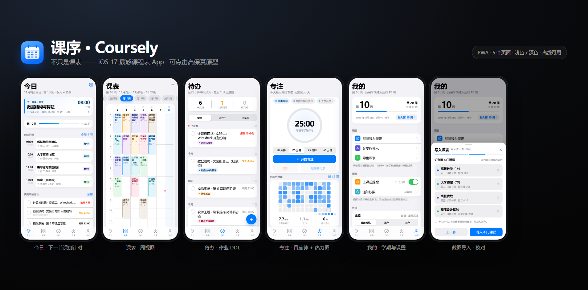
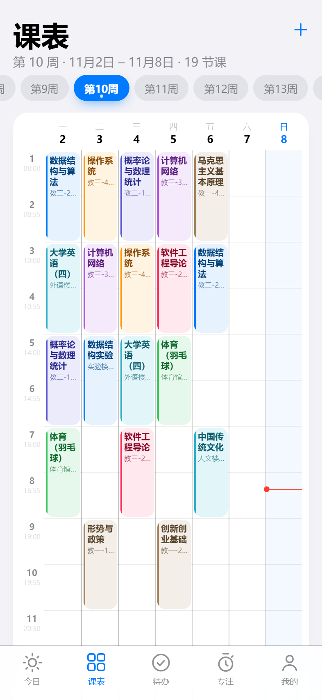
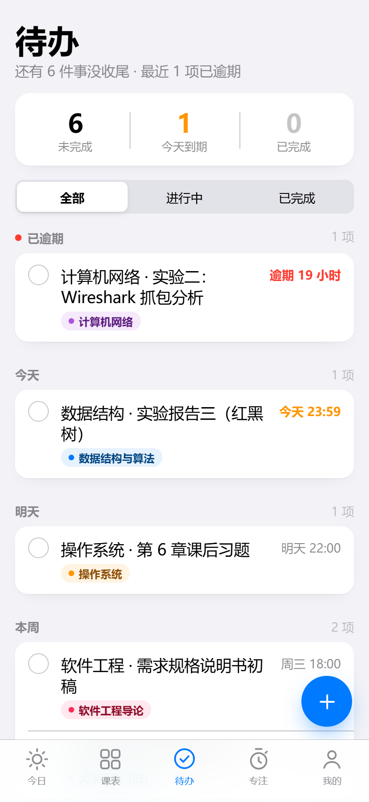
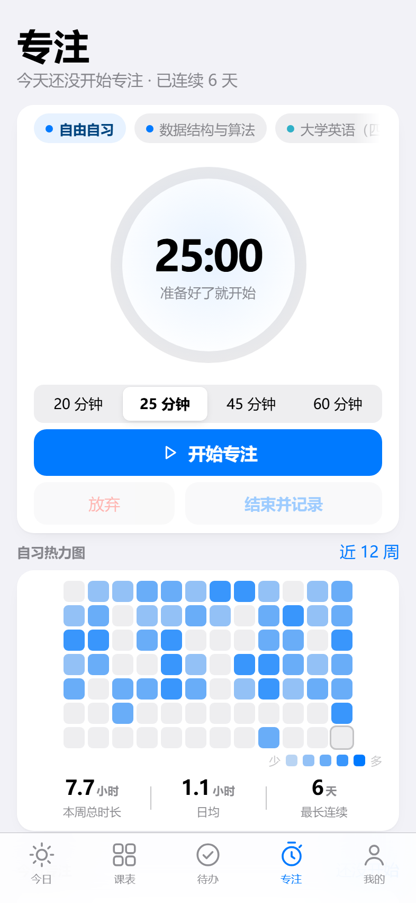
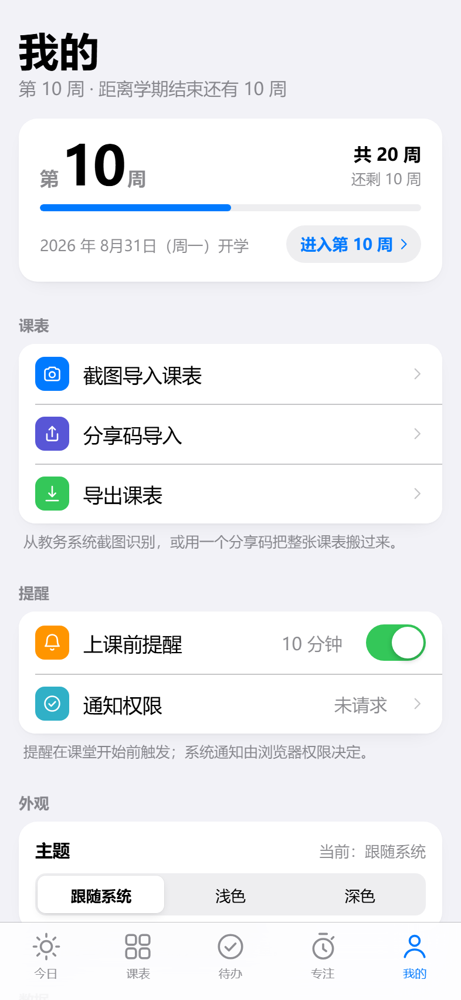

# 课序 · Coursely

> **不只是课表。** 一个 iOS 17 质感、可点击、真能存数据的课程表 App 原型（PWA）。
> 课程表 / 下一节课倒计时 / 作业 DDL / 专注番茄钟 / 截图导入 —— 串成一条线。



---

## 1. 立即体验

```bash
cd web/
node tools/serve.js 8765
# 打开 http://127.0.0.1:8765/
```

- **电脑上看**：宽屏会自动套上 iPhone 外壳，窄屏就是全屏 App。
- **手机上体验**：手机与电脑同一 Wi-Fi，访问 `http://<电脑IP>:8765/`，
  iOS Safari「分享 → 添加到主屏幕」即可全屏运行（PWA standalone，已配 manifest + Service Worker 离线缓存）。
- **没网也能用**：首次打开后资源进缓存，断网刷新仍然可用。

> 数据只存在本机 `localStorage`，无账号、无网络请求。

---

## 2. 需求对齐结论（本次确认）

| 问题 | 你的选择 |
|---|---|
| 形态 | **PWA / Web App** |
| 本轮交付 | **可点击的高保真原型** |
| 必做增强 | 下一节课常驻卡片、待办 & 作业 DDL、专注番茄钟 + 自习热力图、课表导入（粘贴 / OCR / 分享码） |
| 课表数据来源 | ~~截图 OCR~~ → **改为「粘贴导入」**（v0.6.0：文本无损，实测准确率高；OCR 降为实验功能） |

---

## 3. 五个页面

### ① 今日 —— 打开就知道「现在该干什么」
- **下一节课 hero 卡**：正在上课显示剩余倒计时、未开始显示距开课倒计时、隔天显示明几点，
  每秒刷新，点开进课程详情。
- **每日暖言**：周进度下面一张柔和的小卡，按日期确定性挑一条（同一天始终同一条，跨天自动换），
  工作日/周末用不同的语料池；轻点卡片换下一条，配色跟着轮转。不占导航栏。
- **今天的课时间轴**：已上完的淡出、正在上的高亮描边 + 「进行中」标签。
- 今天没课时自动切成**「明天的课」**，不再给一块空白。
- 学期进度条（第 N 周 / 共 20 周）、快到期的作业摘要、快捷入口。

### ② 课表 —— 周视图
- 1–20 周任意切换，当前周打点，「回到本周」一键回位。
- 课程块按连上节次自动跨度，8 套柔和配色；当前时间红色游标只在今天的列出现。
- 点课程 → 详情（教师/地点/周次/学分/备注）→ 编辑 / 删除。
- 右上 ＋ 添加课程：星期选择、开始节次 + 连上节次、起止周 + 单双周、
  配色选择、**时间冲突检测**（冲突时二次确认）、实时「共 N 周」预览。

### ③ 待办 —— 作业 DDL 雷达
- 顶部三宫格（未完成 / 今天到期 / 已完成）+ 全部 / 进行中 / 已完成分段。
- 按 **已逾期 / 今天 / 明天 / 本周 / 以后 / 已完成** 自动分组，
  逾期红、今天橙，DDL 精确到分钟。
- 勾选圆圈即完成（haptic + 删除线 + 归组），点行编辑 / 删除，右下 ＋ 新建。

### ④ 专注 —— 番茄钟 + 自习热力图
- SVG 圆环倒计时，20/25/45/60 分钟快选，开始 / 暂停 / 放弃 / 结束并记录。
- 近 12 周 × 7 天的 GitHub 风格热力图，5 档色阶。
- 统计：本周总时长 / 日均 / 最长连续天数。

### ⑤ 我的 + 导入 + **全部自定义入口**
- **学期设置**：开学日期（日期选择 + 「本周一 / 上周一 / 下周一」快捷）、学期总周数（16/18/20/22 快捷或自定义 1–30），
  面板里实时预览「第 1 周是几号」「今天是第几周」；不是周一会提醒你。
- **作息时间**：节次数 8/10/12/14 一键切换，或逐节改上课 / 下课时间；保存时会提示「有几门课的节次超出新作息」并自动截断。
  改完时间轴、提醒、课表格子高度、桌面小组件全部跟着变。
- **提醒**：只剩**作业到期提醒**（截止前 30 分钟）+ **免打扰时段**（跨零点静默，如 23:00–07:00）。上课前提醒已移除。
- **每日暖言**：可关、可换成自己的句子（一行一句，最多 100 条，留空则用内置 60 余条）。
- **课表导入：以「粘贴」为主路径**
  - **粘贴导入（推荐）**：手机浏览器打开教务系统 → 长按表格全选复制 → 回 App 粘贴 → 解析 → 校对 → 导入。
    文本无损，准确率接近 100%，**不需要联网、不需要拍照**。支持三种输入：
    教务系统表格复制、Excel 复制、手写「一行一门」（`课程名,周X,开始节,节数,教室,周次`）。
  - **截图识别（实验）**：拍照 → 本地 OCR → 校对。受照片质量与版面影响，准确率不稳定，已降为备选。
  - **分享码**：一键复制整份数据（含待办、专注记录），对方粘贴即恢复。
- 通知权限状态、外观三档（跟随系统 / 浅色 / 深色）、**清空所有数据**。
- 所有设置都在这一页按分组收敛，**不占导航栏、不额外加二级页**。

| 课表 | 待办 | 专注 | 我的 |
|---|---|---|---|
|  |  |  |  |

---

## 4. 设计规范（`css/tokens.css`）

| 项 | 取值 |
|---|---|
| 背景 | 浅色 `#F2F2F7` / 深色 `#000`，卡片 `#FFF` / `#1C1C1E` |
| 强调色 | 系统蓝 `#007AFF`（深色 `#0A84FF`） |
| 文字 | `--label` 主 / `--label-2` 次 / `--label-3` 占位 / `--label-4` 极淡 |
| 字体 | SF Pro / PingFang SC，Large Title 34/700，Body 17，Footnote 13 |
| 圆角 | 卡片 16 / 列表 14 / 按钮 12 / 胶囊 999 |
| 材质 | 导航 & Tab Bar 用 `backdrop-filter: blur(24px) saturate(180%)` |
| 动效 | `cubic-bezier(.32,.72,0,1)` 220ms；面板上滑 `.38s`；按下 `scale(.97)` |
| 课程色板 | `.tone-1…8`，每套含 `--tone` / `--tone-soft` / `--tone-ink`，深色自动换档 |
| 热区 | 所有可点元素 ≥ 44pt |

深色模式：`[data-theme="dark"]` 整套变量换档，页面代码零改动。

---

## 5. 目录结构

```
coursely/
├── index.html              # 外壳：状态栏 / 导航 / 页面容器 / Tab Bar / 弹层
├── manifest.webmanifest    # PWA
├── sw.js                   # Service Worker（network-first + 离线回退）
├── css/
│   ├── tokens.css          # 设计 token（颜色/圆角/阴影/动效/课程色板）
│   ├── base.css            # 组件库：卡片/列表/按钮/分段/表单/Sheet/Toast/TabBar
│   ├── today.css  schedule.css  todos.css  focus.css  me.css
├── js/
│   ├── store.js            # 唯一数据源：状态 + localStorage + 订阅 + 演示种子数据
│   ├── domain.js           # 派生计算：周次/时间轴/下一节课/待办分组/专注统计
│   ├── ui.js               # DOM 助手、图标库、Sheet/Alert/Toast
│   ├── app.js              # 路由、Tab、主题、提醒引擎、PWA 注册
│   └── pages/              # today / schedule / todos / focus / me
├── assets/icon.svg
├── tools/serve.js          # 零依赖静态服务器
├── tools/shot.js           # 零依赖截图/交互调试器（CDP）
└── CONTRACT.md             # 团队协作契约（架构/接口/设计系统）
```

无构建步骤、无依赖、无框架 —— 打开就能跑，改完刷新就生效。

---

## 6. 原型 ≠ 正式版（如实说明）

| 能力 | 当前原型 | 正式版要做的 |
|---|---|---|
| 课表导入 | **粘贴导入已真可用**（解析实测 5 种输入格式全部正确）；Android 包里的截图识别是**真 ML Kit 离线 OCR**，浏览器预览里是模拟结果 | 以粘贴为主；OCR 继续做实验功能，或按学校接教务系统 |
| 上课/DDL 提醒 | 页内轮询 + Web Notification | Service Worker + Push，或原生本地通知（关掉 App 也能响） |
| 小组件 / 灵动岛 / 锁屏 | Web 做不了 | M3 用原生壳（SwiftUI WidgetKit / ActivityKit） |
| 数据同步 | 本机 localStorage + 分享码 | 账号 + 云端同步（CloudKit / 自建后端） |
| 空教室查询 | 未做 | 依赖学校教室数据源 |

---

## 7. 后续路线（M1 → M3）

**M1 · 能天天用（2 周量级）**
- 真实 OCR 接入 + 教务系统导入适配（正方 / 强智 / URP）
- 通知真正后台化（SW + Push 或原生）
- 课表手势：长按拖动换课、双指缩放周次
- 数据导出 CSV / 图片分享

**M2 · 长出血肉**
- 成绩 & GPA（4.0 / 5.0 换算、挂科预警、学期趋势）
- 考试倒计时 + 学期日历（节假日调休）
- 专注白噪音 / 学霸模式（锁机）
- 空教室查询

**M3 · 上桌面**
- 原生壳：SwiftUI + WidgetKit 小组件、锁屏组件、灵动岛「下一节课」
- iCloud 同步 + 多端

---

## 8. 开发小工具

```bash
# 起服务（改文件刷新即生效）
node tools/serve.js 8765

# 截图某个页面（无头 Edge + CDP，可注入交互）
node tools/shot.js http://127.0.0.1:8765/ ../docs/screenshots/x.png \
    --eval "document.querySelector('[data-page=schedule]').click()"
node tools/shot.js http://127.0.0.1:8765/ ../docs/screenshots/dark.png --dark
```

---

## 9. 已知限制（原型阶段，如实列出）

**数据与演示**
- **不内置任何示例数据**：全新安装是空课表，默认从「本周一」算第 1 周；首次使用走「粘贴导入」或手动添加。
- v0.7.0 换过存储版本号（v1 → v2），旧版本的示例课表不会被迁移过来，升级后需要重新导入一次。
- 分享码是**整份 state 的 base64**（约 39KB，含课表 + 待办 + 专注记录 + 主题），导入语义是**整体替换**本机数据，不是合并。
- 首次进入有一条欢迎 Toast，属正常。

**功能边界**
- 番茄钟：切 tab / 刷新会**丢掉进行中的计时**（`destroy()` 会复位），不保留后台计时。
  正式版应改为「记录开始时间戳 + `visibilitychange` 补偿」，而不是依赖 `setInterval`。
- 待办的时间选择用原生 `<input type="datetime-local">`（iOS 上是系统滚轮，桌面 Edge 显示原生日期控件），未做自定义日历。
- 右下 FAB 是屏幕固定定位，滚动过程中会浮在某一行右侧上方（iOS 常规行为），已用 64px 尾部留白保证不遮挡内容。
- 专注页热力图格子为 **20px**（原计划 11px）—— 12 周 × 20px 才能既铺满 393 宽又在首屏露出，属刻意取舍。
  桌面「手机框」预览（顶部让出 56px 状态栏）时，专注页统计行需要滚一屏才可见。

**运行环境**
- 桌面端浏览器才显示 iPhone 外壳（宽 ≥ 640px 且高 ≥ 700px），手机上是全屏。
- 通知权限在浏览器里需手动允许；无 HTTPS 域名时部分浏览器会拦截。
- Service Worker 需要 http(s) 协议，直接双击 `index.html`（file://）时不会注册。

---

## 10. 截图索引

| 文件 | 内容 |
|---|---|
| `../docs/screenshots/cover.png` | 五页总览（交付封面） |
| `../docs/screenshots/today.png` / `todos.png` / `schedule.png` / `focus.png` / `me.png` | 五个主页面（浅色） |
| `../docs/screenshots/dark-today.png` / `dark-schedule.png` / `focus-dark-852.png` / `me-dark.png` | 深色模式 |
| `../docs/screenshots/desktop.png` | 桌面预览（iPhone 外壳 + 状态栏 + 灵动岛） |
| `../docs/screenshots/import-3-preview.png` / `import-4-progress.png` / `import-review.png` / `import-7-schedule.png` | 截图导入 4 步 |
| `../docs/screenshots/menu-add.png` / `sch-add.png` | 课表 ＋ 菜单 / 添加课程表单 |
| `../docs/screenshots/extra/` | 开发过程截图（含待办勾选、专注进行中、分享码、深色导入等） |
